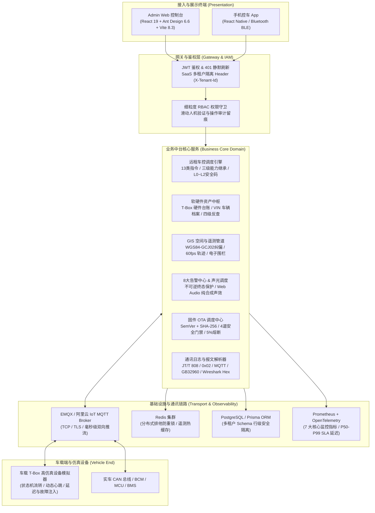

# 手机控车平台 (Car Control Platform) · 企业级全栈车联网运营与监控中台

[](https://react.dev/)
[](https://www.typescriptlang.org/)
[](https://ant.design/)
[-646cff?logo=vite&logoColor=white)](https://vite.dev/)
[](https://nestjs.com/)
[-52c41a)](file:///Users/mac/Work/AI/car-control-platform/.superpowers/sdd/2026-10-10-admin-web-console/progress.md)
[](file:///Users/mac/Work/AI/car-control-platform/apps/web/vite.config.ts)

**手机控车平台 (Car Control Platform)** 是一套面向新能源汽车、智慧出行车队及智能网联后装市场的企业级全栈车联网运营与监控管理中台。
覆盖高并发指令调度、SaaS 多租户数据隔离、软硬件资产治理、实时 GIS 监控、固件 OTA 批次调度、原始报文逆向解析与微服务集群观测等全场景业务闭环。

---

## 🌟 核心业务架构与能力全景



---

## 🚀 核心交付特性与亮点

### 1. 平台中枢与多租户权限体系 (IAM & Tenant Isolation)

- **SaaS 多租户隔离**：全局请求头自动绑定 `X-Tenant-Id`，所有表格与下拉列表仅展示当前租户范围内的资源，严禁跨租户数据串扰。
- **无感静默刷新机制**：双 Token 认证架构，401 过期时前端静默换发新 Token 并无缝重发原请求，用户操作不中断。
- **细粒度 RBAC 与操作审计**：用户、角色与权限点精确映射；支持操作日志异步落库（操作人、模块、IP、前后状态差异）。

### 2. 车物资产中心与四级归属链路 (Asset & Hardware Management)

- **硬件台账与严格格式校验**：严格校验 15 位 IMEI、20 位 ICCID 与 17 位 ISO 3779 VIN 车辆编码，杜绝非法字符与格式错误。
- **原子化绑定/解绑状态机**：车辆与 T-Box 软硬件一键绑定/转让，解绑原因字典归档，支持硬件配额硬约束与批量 Excel 导入。
- **四级资产追溯链路**：`设备 (Device) -> 车辆 (Vehicle) -> 项目 (Project) -> 租户 (Tenant)` 四级全生命周期拓扑反查。

### 3. 远程车控工作台与三级能力继承引擎 (Car Control & Capability)

- **13 类远程控车指令全覆盖**：车门解闭锁、空调开关与温度风量、车窗升降、寻车闪灯鸣笛、后备箱、天窗、数字钥匙授权与紧急断电等。
- **三级能力继承解析引擎**：`全局指令字典 -> 车型标准模板 -> 单车专属覆盖` 三级级联覆盖，精确计算有效能力与安全等级。
- **高可用控车安全防线**：
  - **L0/L1/L2 动态安全码**：高危指令强制二次验证；
  - **滑动窗口频次限流**：单车高频请求限流保护；
  - **分布式 Redis 排他防重锁**：`lock:cmd:${tenantId}:${vehicleId}` 10s TTL，防止相同车辆并发指令碰撞（409 友好拦截）。

### 4. GIS 空间监控、60fps 轨迹回放与电子围栏 (Location & Geofencing)

- **零外部 Key 依赖的高性能纯数学 GIS 底座**：
  - 内置 WGS-84（GPS 原始大地坐标）与 GCJ-02（国家测绘局火星坐标）双向定点收敛算法；
  - 自研 Web Mercator 像素投影、近邻空间贪心聚类算法与对数自适应最佳缩放（Zoom 3~18）；
  - 提供标准路网（Standard）、夜间驾驶舱（Dark）与仿卫星绿地（Satellite）三大主题图层。
- **60fps 最短角跨零航向平滑插值播放器**：
  - 消除正北跨越（如 $350^\circ \to 10^\circ$）车头倒转视觉抖动；
  - 集成滑动窗口质心消抖停驻点识别与 Douglas-Peucker 矢量抽稀算法。
- **电子围栏几何碰撞检测**：
  - 圆形围栏（Haversine 大圆距离）与任意多边形围栏（Ray-Casting 射线法与 Winding Number 原理）；
  - 高斯 Shoelace 鞋带面积算法（首顶点相对平移消除大数浮点截断误差）。

### 5. 8 大异常告警中心与 Web Audio 纯合成声效 (Alarm Center)

- **8 大告警类型全覆盖**：低电压（LOW_BATTERY）、异常震动（VIBRATION）、超速（OVERSPEED）、剪线报警（POWER_CUT）、SOS紧急呼救（SOS）、拖车报警（TOW_AWAY）、进围栏（GEOFENCE_IN）、出围栏（GEOFENCE_OUT）。
- **不可逆绝对终态防线**：`PROCESSED`（已处理）与 `IGNORED`（已忽略）状态前端与 API 双层拦截反向流转，人工处置强制要求录入 2~200 字原因并留存审计履历。
- **Web Audio API 纯合成声效引擎**：零外部音频文件网络依赖，原生合成方波/正弦波紧急双音脉冲（CRITICAL 880Hz/1760Hz 紧急双鸣，WARNING 660Hz 双音，INFO 440Hz 单音），支持持久化静音配置与顶栏待处置徽标实时联动。

### 6. 固件 OTA 升级工作台与四道防变砖门禁 (Firmware OTA Management)

- **SemVer 正则与 64 位 SHA-256 完整性防线**：TBOX/MCU/BCM/BMS 四类固件规格全覆盖，重复包名 409 防重，非草稿版本物理删除拦截。
- **四道硬件安全前置门禁**：
  - 门禁一：最低动力电池 SoC 必须 $\ge 20\%$（默认 $30\%$）；
  - 门禁二：车辆必须处于静止挂 P 档状态（车速强制校验为 0 km/h）；
  - 门禁三：大电流充电过程规避；
  - 门禁四：5% 失败率全自动熔断阈值（Circuit Breaker）。
- **单车全链路 4 阶段时间线跟踪**：`PENDING` -> `DOWNLOADING` -> `DOWNLOADED` -> `UPGRADING` -> `SUCCESS` / `FAILED`，支持失败车辆一键批量重试。

### 7. 原始通讯日志与 Wireshark 风格报文解析器 (Communication Log & Hex Viewer)

- **车联网主流协议全覆盖**：交通部 JT/T 808、0x02 远程车控、MQTT 遥测上行包与 GB/T 32960 新能源国标报文。
- **JT/T 808 异或校验验算与转义还原**：自动识别 `0x7d 0x02 -> 0x7e` 转义序列，支持异常报文交互式重新验算。
- **Wireshark 风格 16 字节十六进制矩阵**：4 位十六进制 Offset 偏移量、16 字节 Hex 原始码与 ASCII 安全可打印字符三栏对照。
- **工业级导出安全防线**：RFC 4180 规范 CSV 导出，前置 `\uFEFF` UTF-8 BOM 杜绝 Windows Excel 中文乱码，严格实施 CWE-1236 电子表格公式注入防御。

### 8. 运营全景大屏与系统 Prometheus 监控看板 (Cockpit & Observability)

- **0 外部图表库依赖 (Pure Native SVG/CSS)**：
  - 杜绝引入重量级外部图表包（echarts/recharts 等），采用纯原生 SVG 矢量绘制（24h 双曲线渐变面积图、原生 CSS 柱状图、纯原生 SVG 环形 Donut 图）；
  - 秒级加载且完美自适应深浅主题 tokens。
- **Prometheus 7 大后端核心指标解析与分位数算法**：
  - 完整解析 `GET /metrics` 导出的指令吞吐、延迟直方图、遥测速率、告警计数、活跃模拟器、WebSocket 长连接与 Redis 排他锁争抢；
  - 遵循 Prometheus 官方规范纯数学实现阶梯桶线性内插分位数算法，精确计算 $P_{50}, P_{90}, P_{99}$ SLA 指令响应延迟；
  - 8 大微服务节点健康矩阵（API Gateway, Car Control Core, Telemetry Processor, OTA Scheduler, Alarm Dispatcher, EMQX Broker, Redis Cluster, Postgres DB）与 EMQX 消息队列吞吐监控。

---

## 🧭 侧边栏 14 大核心业务菜单契约

系统严格保证侧边栏菜单数量恒定契约（`getMenuRoutes().length === 14`），当前 14 大核心业务视图 100% 实体化挂载，无任何空置或 mock 占位：


| 序号 | 路由路径     | 导航菜单名称       | 所属分类   | 实体化核心组件                                                                          | 业务功能概览                                               |
| :--: | ------------ | ------------------ | ---------- | --------------------------------------------------------------------------------------- | ---------------------------------------------------------- |
|  1  | `/dashboard` | **运营看板**       | 概览看板   | [`OperationalDashboardView`](apps/web/src/views/dashboard/OperationalDashboardView.tsx) | 纳管规模、在线率、今日指令、今日告警、活跃车主与动态流大屏 |
|  2  | `/tenants`   | **租户管理**       | 平台中枢   | [`TenantListView`](apps/web/src/views/tenant/TenantListView.tsx)                        | SaaS 租户生命周期、设备配额硬约束与管理员账号配置          |
|  3  | `/orgs`      | **机构管理**       | 平台中枢   | [`OrgTreeView`](apps/web/src/views/tenant/OrgTreeView.tsx)                              | 多级组织树状拓扑、行政层级划分与数据隔离范围管理           |
|  4  | `/users`     | **用户管理**       | 平台中枢   | [`UserListView`](apps/web/src/views/rbac/UserListView.tsx)                              | 平台管理员账户增删改查、机构绑定与状态启停                 |
|  5  | `/roles`     | **角色权限**       | 平台中枢   | [`RolePermissionView`](apps/web/src/views/rbac/RolePermissionView.tsx)                  | 细粒度 RBAC 权限配置、菜单权限与操作按钮级权限分配         |
|  6  | `/devices`   | **设备管理**       | 资产管理   | [`DeviceListView`](apps/web/src/views/device/DeviceListView.tsx)                        | T-Box/车机硬件资产台账、批量导入、参数设置与网络状态诊断   |
|  7  | `/vehicles`  | **车辆管理**       | 资产管理   | [`VehicleListView`](apps/web/src/views/vehicle/VehicleListView.tsx)                     | 车辆档案管理、17位VIN校验、软硬件一键绑定/转让与实时车况   |
|  8  | `/commands`  | **车控中心**       | 车控运营   | [`CarControlWorkbench`](apps/web/src/views/command/CarControlWorkbench.tsx)             | 13类远程车控操作工作台、安全码校验与全生命周期实时流水     |
|  9  | `/telemetry` | **实时定位与轨迹** | 位置与围栏 | [`RealtimeLocationMap`](apps/web/src/views/telemetry/RealtimeLocationMap.tsx)           | 多车实时地图打点聚合、60fps 抽稀历史轨迹回放播放器         |
|  10  | `/geofence`  | **电子围栏**       | 位置与围栏 | [`GeofenceManageView`](apps/web/src/views/telemetry/GeofenceManageView.tsx)             | 圆形/多边形围栏地图交互编辑与出入告警联动规则配置          |
|  11  | `/alarms`    | **报警中心**       | 运维保障   | [`AlertCenterView`](apps/web/src/views/alarm/AlertCenterView.tsx)                       | 8大车况告警检索、声光弹窗推送与人工闭环处置抽屉            |
|  12  | `/ota`       | **固件升级**       | 运维保障   | [`OtaWorkbenchView`](apps/web/src/views/ota/OtaWorkbenchView.tsx)                       | 固件版本库完整性校验、分批升级调度向导与全链路进度追踪     |
|  13  | `/logs`      | **通讯日志**       | 运维保障   | [`CommLogSearchView`](apps/web/src/views/log/CommLogSearchView.tsx)                     | TCP/MQTT上行下行报文检索、Wireshark 风格 Hex 与 JSON 解析  |
|  14  | `/monitor`   | **运维监控**       | 运维保障   | [`SystemMetricsView`](apps/web/src/views/monitor/SystemMetricsView.tsx)                 | Prometheus微服务指标可视化、分布式锁与QPS吞吐监控          |

*(注：二级管理页面与配置抽屉如车型档案 `/models`、项目配置 `/projects`、能力模板 `/capabilities`、数字钥匙 `/digital-keys`、指令字典 `/command-dictionary` 均按规约标记 `hideInMenu: true`，并通过业务上下文无缝联动)*

---

## 🏗️ 代码库目录组织 (Monorepo Workspace)

```text
car-control-platform/
├── apps/
│   ├── web/                    # React 19 + TypeScript + Ant Design 6 + Vite 8 管理后台
│   │   ├── src/
│   │   │   ├── api/            # API 客户端 (axios 拦截器、401静默刷新、离线降级状态池)
│   │   │   ├── views/          # 14 大核心业务视图 (auth, tenant, rbac, device, vehicle, command, telemetry, alarm, ota, log, dashboard, monitor)
│   │   │   ├── layouts/        # Ant Design 6 AdminLayout 侧边栏主架构与顶栏声光微标
│   │   │   ├── router/         # 14-menu 恒定契约路由体系与权限过滤引擎
│   │   │   └── test/           # 644 项纯原生 TDD 自动化测试用例
│   │   └── vite.config.ts      # Vite 8.3 + Rolldown Rust 统一极速构建配置
│   ├── api/                    # NestJS 12 后端业务微服务集群
│   │   ├── src/
│   │   │   ├── auth/           # JWT 双 Token 认证中心与 RBAC 守卫
│   │   │   ├── tenant/         # 多租户管理与组织机构树
│   │   │   ├── device/         # 硬件设备资产服务与导入校验
│   │   │   ├── vehicle/        # 车辆档案与软硬件配对状态机
│   │   │   ├── command/        # 12 步控车安全流水线与 ACK 超时恢复闭环
│   │   │   ├── telemetry/      # 遥测上行处理管道与 GPS 坐标纠偏
│   │   │   ├── alarm/          # 8 大告警引擎与 WebSocket 实时广播
│   │   │   ├── ota/            # 固件包管理与批量分批调度服务
│   │   │   └── observability/  # Prometheus 指标导出器 (GET /metrics) 与分布式链路跟踪
│   │   └── test/               # 112 项 API 端到端集成与高可用验收测试套件
│   ├── simulator/              # 车载 T-Box 仿真设备模拟器 (MQTT 注册/心跳/ACK/异常注入)
│   └── worker/                 # BullMQ 异步队列与超时任务处理器
├── packages/
│   ├── contracts/              # 跨端共享 DTOs、Command 状态机、MQTT/WS 协议契约
│   ├── domain-types/           # 共享领域实体、枚举与核心领域事件
│   ├── crypto/                 # 密码学安全验证、校验和计算与敏感数据加解密
│   ├── database/               # Prisma ORM Schema 与多租户隔离数据仓储底座
│   └── config/                 # 环境配置校验与加载器
├── docs/                       # 188 项需求矩阵、Pilot 页面规格、设计 Tokens 与 ADR 架构决策
├── AGENTS.md                   # AI 协作规范与工程红线约束
├── ARCHITECTURE.md             # 系统全景架构设计文档
├── ROADMAP.md                  # 24 周交付路线图与质量门禁规范
└── README.md                   # 项目综合介绍与快速启动指南
```

---

## 🛠️ 技术栈与工程规范


| 层次           | 技术选型            | 关键版本     | 架构价值与设计决策                                                                           |
| -------------- | ------------------- | ------------ | -------------------------------------------------------------------------------------------- |
| **UI 视图**    | React               | `19.3.0`     | 采用全新 Actions、use 钩子与高性能并发渲染                                                   |
| **组件框架**   | Ant Design          | `6.6.5`      | 原生纯 CSS 变量架构 (`cssVar: true`)，`styles={{ body: ... }}`，彻底杜绝已废弃的 `bodyStyle` |
| **图标库**     | `@ant-design/icons` | `6.3.4`      | Ant Design 6 配套现代化高性能矢量图标                                                        |
| **前端构建**   | Vite                | `8.3.4`      | 基于 Rolldown Rust 统一极速构建内核，**~790ms 秒级全量编译**                                 |
| **语言规范**   | TypeScript          | `5.8.2`      | 严格模式 (`strict: true`)，全栈端到端类型安全                                                |
| **前端状态**   | Zustand             | `5.0.15`     | 轻量化、免 Context 穿透的持久化响应式状态中枢                                                |
| **后端框架**   | NestJS              | `12.0.x`     | 模块化企业级 IoC/DI 架构，微服务与控制器规范分层                                             |
| **数据持久化** | PostgreSQL + Prisma | `16+` / `6+` | 行级租户隔离、高并发事务安全与关系完整性约束                                                 |
| **分布式缓存** | Redis               | `7+`         | `SET NX PX` 并发排他防重锁、遥测热点缓存与会话状态共享                                       |
| **消息中间件** | EMQX / MQTT         | `5+`         | 车联网高并发千万级长连接、QoS 1 消息必达与双向推流                                           |
| **测试套件**   | Node.js Test Runner | `Node.js 22` | 原生零外部测试依赖，并发毫秒级执行 756 项测试套件                                            |

---

## ⚡ 快速开始与本地运行

### 1. 运行环境要求

- **Node.js**: $\ge 22.0.0$ (推荐 Node.js 22 LTS)
- **pnpm**: $\ge 10.0.0$
- **Docker**: (可选，用于本地一键运行 PostgreSQL, Redis, EMQX)

### 2. 安装依赖与全量编译

```bash
# 切换至项目根目录
cd car-control-platform

# 一键安装 Monorepo 依赖
pnpm install

# 编译所有 packages 与前端工程
pnpm build
```

### 3. 执行全量自动化测试套件 (质量门禁)

```bash
# 运行全 Monorepo 756 项测试套件 (Web 644项 + API 112项)
pnpm test

# 单独运行前端测试套件 (644 项测试通过)
pnpm --filter @car-control/web test

# 单独验证前端生产构建 (TypeScript 类型检查 + Vite 8 编译)
pnpm --filter @car-control/web build
```

### 4. 本地启动服务进行联调与体验

建议在不同终端窗口分别启动以下服务：

#### 终端 1：启动车载 T-Box 高仿真设备模拟器

```bash
pnpm --filter @car-control/simulator start
```

#### 终端 2：启动后端业务 API 服务 (默认端口 3000)

```bash
pnpm --filter @car-control/api start:dev
```

#### 终端 3：启动前端 Web 控制台 (默认端口 5173)

```bash
pnpm --filter @car-control/web dev
```

启动完成后，使用浏览器访问：**[http://localhost:5173](http://localhost:5173)**。

---

## 🔐 预置体验账号与多租户说明

系统内置了高保真演示数据与离线降级状态池，即便未启动后端数据库，前端控制台亦可全功能无缝离线体验与演示：


| 账号身份             | 登录用户名       | 登录密码        | 所属租户                        | 可访问菜单范围                            |
| -------------------- | ---------------- | --------------- | ------------------------------- | ----------------------------------------- |
| **超级管理员**       | `admin`          | `Admin@123456`  | 全部租户 (具备切换权限)         | **全部 14 大业务菜单** 及所有二级配置抽屉 |
| **Alpha 车队运营员** | `operator_alpha` | `Oper@123456`   | Alpha 智联车队 (`tenant-alpha`) | 资产管理、车控中心、位置监控与报警中心    |
| **运维监控专员**     | `devops_user`    | `DevOps@123456` | 系统全局运维                    | 固件升级、通讯日志、系统运维监控大屏      |

*(登录页面已内置一键填充体验凭证与纯前端智能滑块验证码，拖动滑块即可快速登录进入)*

---

## 📄 验收签署与交付记录

- [Sprint 0: 产品定义与设计基线 (Commit `5748445`)](file:///Users/mac/Work/AI/car-control-platform/docs/product/requirements-map.md)
- [Sprint 1: 平台骨架与 IAM 组织底座 (62 Web Tests, 174 Monorepo Tests)](file:///Users/mac/Work/AI/car-control-platform/.superpowers/sdd/2026-10-10-admin-web-console/sprint-1-acceptance-report.md)
- [Sprint 2: 设备、车辆与项目资产管理中心 (165 Web Tests, 277 Monorepo Tests)](file:///Users/mac/Work/AI/car-control-platform/.superpowers/sdd/2026-10-10-admin-web-console/sprint-2-acceptance-report.md)
- [Sprint 3: 远程车控运营台与能力配置中心 (313 Web Tests, 425 Monorepo Tests)](file:///Users/mac/Work/AI/car-control-platform/.superpowers/sdd/2026-10-10-admin-web-console/sprint-3-acceptance-report.md)
- [Sprint 4: 地图实时监控、历史轨迹回放、电子围栏与报警中心 (461 Web Tests, 573 Monorepo Tests)](file:///Users/mac/Work/AI/car-control-platform/.superpowers/sdd/2026-10-10-admin-web-console/sprint-4-acceptance-report.md)
- [Sprint 5: 固件 OTA 升级工作台、通讯日志、运营全景大屏与系统运维监控 (644 Web Tests, 756 Monorepo Tests)](file:///Users/mac/Work/AI/car-control-platform/.superpowers/sdd/2026-10-10-admin-web-console/sprint-5-acceptance-report.md)

---

## ⚖️ 知识产权与许可 (License)

本项目遵循企业私有商业软件规范开发，版权归手机控车平台产研团队所有。
