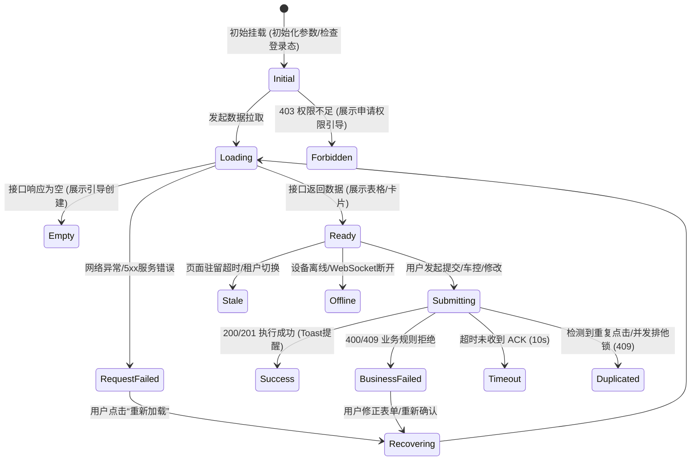

# 手机控车平台 Admin 管理后台 · 组件交互与 13 类状态规范 (Component & State Guidelines)

> **文档版本**：v1.0 (Sprint 0 基线)  
> **制定依据**：《手机控车平台功能清单.docx》第 23 模块（自然交互语言与人性化容错）及 V2.1 规划  
> **归属路径**：`docs/design/component-guidelines.md`

---

## 1. 业务页面全生命周期 13 类交互状态规格

每个业务页面与交互组件（尤其是列表、表单、监控面板、控制按钮）必须具备完整的状态定义，严禁仅实现“请求成功”一种理想状态：



### 13 类状态详细定义与交互模式：

| 状态序号 | 状态名称 | 触发条件 | UI 表现模式 | 恢复与后续操作路径 |
|---|---|---|---|---|
| **1** | **初始态 (Initial)** | 页面刚打开，准备就绪 | 占位骨架屏 (Skeleton)，不闪烁空列表 | 自动触发首屏 API 拉取 |
| **2** | **加载态 (Loading)** | 正在拉取后端数据 | 表格内置 loading 转圈，按钮置为 loading | 禁用干扰操作，保持原有筛选条件 |
| **3** | **空数据 (Empty)** | 租户名下暂无该类数据 | Ant Design 6 `Empty` 组件，展示拟人化插画与“暂无车辆数据”说明 | 提供明确的主操作按钮（如“+ 立即建档”、“导入设备”） |
| **4** | **请求失败 (Failed)** | 网络断开或服务端返回 500 | `Alert type="error"` 错误通告栏，简要描述“网络连接异常” | 提供“点击重试”按钮，保留用户已输入的筛选条件 |
| **5** | **无权限 (Forbidden)** | 接口返回 403 Forbidden | `Result status="403"`，提示“您暂无查看该项目的权限” | 提供“返回首页”或“联系管理员分配权限”入口 |
| **6** | **数据过期 (Stale)** | 页面打开后长时间未操作或切换了租户 | 页面顶部提示“检测到租户上下文已变更” | 提供“一键刷新数据”按钮 |
| **7** | **离线状态 (Offline)** | 目标车辆/设备已超 300s 未发心跳 | 设备编号旁标注灰色 `OFFLINE` 标签，远程控车按钮禁用 | 悬停 Tooltip 提示“设备处于离线状态，指令无法即时送达” |
| **8** | **提交中 (Submitting)**| 用户点击控车/保存按钮 | 按钮进入 Loading 态，并呈现波纹阻断 | 防止短时间高频重复触发请求 |
| **9** | **操作成功 (Success)** | 后端返回成功，收到终端 ACK | 顶部弹出轻量 `message.success("车门解锁指令执行成功 (耗时 1.2s)")` | 自动刷新关联车况，或关闭弹窗抽屉 |
| **10**| **业务拒绝 (Rejected)**| 设备设防中、正在行车拒绝控车 | 弹出明确原因的 Notification 提示，例如“车机处于点火状态，拒绝远程上锁” | 允许用户查看车况详情并排查原因 |
| **11**| **执行超时 (Timeout)** | 超过 10,000ms 未收到终端 ACK | 提示“指令下发超时，终端暂未应答，已自动终止等待” | 按钮恢复可用，支持重新下发 |
| **12**| **重复防刷 (Duplicated)**| 遭遇 409 `VEHICLE_COMMAND_IN_PROGRESS` | 弹窗友好提示“该车辆正有指令正在执行，请稍候” | 阻断重复请求，聚焦至右侧实时指令流水大屏 |
| **13**| **异常恢复 (Recovering)**| 用户根据提示修正参数或重试 | 撤销错误标记，提供一步恢复默认值按钮 | 用户无需重新刷新整个页面 |

---

## 2. 自然交互语言与文案规范 (Natural Language & Microcopy)

严格遵循《功能清单》23.1 自然交互语言规范，**杜绝生硬、机器化、AI 模版化的词汇**：

### 2.1 错误提示对比规范
- ❌ **严禁使用的生硬文案**：
  - “Error 500: Internal Server Error”
  - “操作失败，发生未知异常”
  - “参数校验未通过”
  - “无法连接到数据库”
- ✅ **推荐采用的自然业务文案**：
  - “当前网络通信繁忙，未能收到设备应答，请稍后刷新重试”
  - “输入的 17 位车辆 VIN 码格式不正确，请检查是否包含非法英文字符 (I/O/Q)”
  - “该车辆当前正在行驶中，为了行车安全，系统已拦截远程熄火操作”
  - “当前租户的设备配额已达上限 (1000/1000)，无法继续导入，请联系平台分配更多配额”

---

## 3. 高危操作防误触与二次确认机制 (High-Risk Confirmation)

系统针对不同危险级别的操作，实施**分级防误触与确认门禁**：

```mermaid
flowchart TD
    Op["用户触发操作"] --> Level{"判断风险等级"}
    
    Level -->|L0: 常规操作 (导出/筛选/换页)| Direct["直接执行 (无打扰)"]
    Level -->|L1: 中危操作 (解绑/删除/开关门锁)| ModalL1["弹出 Popconfirm / 基础 Modal 确认<br>展示影响范围，需点击【确认执行】"]
    Level -->|L2: 高危操作 (远程熄火/批量OTA/租户停用)| ModalL2["弹出强安全确认弹窗<br>1. 必须人工输入操作安全码 (6位密码)<br>2. 展示不可逆法律风险提示<br>3. 校验通过后方可下发"]
```

### 3.1 L1 中危确认（标准确认对话框）
- **触发场景**：车辆解绑设备、删除非活跃用户、远程寻车双闪鸣笛、远程开尾箱。
- **UI 呈现**：Ant Design 6 `Modal.confirm` 或 `Popconfirm`。
- **文案要素**：明确说明后果，例如：“确认解除车辆 **粤B·88888** 与设备 **DEV_1001** 的绑定关系吗？解除后将无法获取实时位置与执行控车。”

### 3.2 L2 强安全确认（安全码校验弹窗）
- **触发场景**：远程熄火、远程点火启动、创建全量设备 OTA 升级任务、停用整个企业租户。
- **UI 呈现**：独立 `SecurityVerifyModal`。
- **交互要求**：
  1. 必须展示黄色或红色警示图标；
  2. 显式列出受影响的目标车辆列表与当前状态；
  3. 提供 6 位纯数字安全密码输入框（掩码显示）；
  4. 支持输错 3 次临时锁定防暴力破解机制；
  5. 记录进入操作审计日志。
