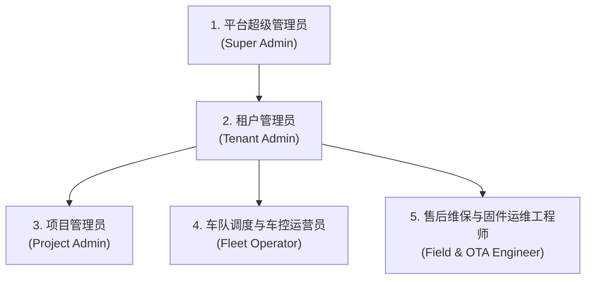
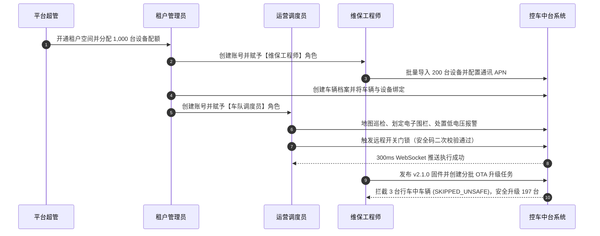

# 手机控车平台 Admin 管理后台 · 用户角色与权限边界定义 (Personas & Boundaries)

> **文档版本**：v1.0 (Sprint 0 基线)  
> **制定依据**：《手机控车平台功能清单.docx》23 模块及系统多租户/项目化架构  
> **归属路径**：`docs/product/personas.md`

---

## 1. 角色全景与权限矩阵

手机控车平台 Admin 管理后台面向以下 **5 大核心用户角色**：

| 角色代码 | 角色名称 | 组织与数据范围 | 核心业务目标 | 关注核心指标与高频页面 |
|---|---|---|---|---|
| `SUPER_ADMIN` | **平台超级管理员** | 全平台所有租户与全局系统数据 | 平台资源分配、租户生命周期、SaaS 配额管控、全局可用性监控与系统审计 | 租户管理 (`/tenants`)、运维监控 (`/monitor`)、审计日志 (`/logs`)、系统指标 |
| `TENANT_ADMIN` | **租户管理员** | 当前租户内所有机构、项目、资产与用户 | 租户组织架构维护、用户权限分配、设备与车辆资产台账管理、资产安全与利用率 | 机构管理 (`/orgs`)、用户与角色 (`/users`, `/roles`)、设备资产 (`/devices`)、车辆管理 (`/vehicles`) |
| `PROJECT_ADMIN` | **项目管理员** | 所属项目内绑定的设备、车辆与运营数据 | 项目内软硬件资产跟踪、项目权限与功能开关配置、项目级运营统计 | 项目管理 (`/projects`)、设备与车辆列表、项目看板 (`/dashboard`) |
| `FLEET_OPERATOR` | **车队调度与车控运营员** | 授权机构或项目管辖的在线车辆 | 实时掌握车辆分布与轨迹、执行远程车控调度、及时响应并闭环人工处置告警 | 实时定位与轨迹 (`/telemetry`)、远程车控工作台 (`/commands`)、电子围栏 (`/geofence`)、告警中心 (`/alarms`) |
| `FIELD_ENGINEER` | **售后维保与固件运维工程师** | 负责设备硬件诊断、批量升级与网络排障 | 设备批量导入激活、参数远程配置、OTA 固件升级批次推进、底层通讯报文纠错 | 设备台账与详情 (`/devices`)、OTA 固件升级工作台 (`/ota`)、通讯日志中心 (`/logs`) |

---

## 2. 角色画像与典型使用场景

### 角色 1：平台超级管理员 (Super Admin)
- **典型人物**：张总工（平台架构师 / 平台总运维）
- **核心诉求**：
  - 了解整套 SaaS 平台的全局负载：当前并发在线设备数、各租户活跃度、API 响应时间与 Prometheus 7 大指标；
  - 掌控租户的入驻开通与资源配额（如 A 租户上限 5000 台设备，超限时触发警告或阻断导入）；
  - 全局追溯敏感操作（如跨租户权限变更、高危安全策略下发）的审计日志。
- **痛点与防错需求**：
  - 严禁在非调试状态下直接下发全局跨租户指令；
  - 切换租户视窗时，系统必须在全局 Header 处有醒目的黄色/蓝色高亮标识，防止在客户 A 的数据中错误配置客户 B 的规则。

---

### 角色 2：租户管理员 (Tenant Admin)
- **典型人物**：李总（某车联网运营企业运营总监）
- **核心诉求**：
  - 自主维护下属分支机构树形架构（如总公司 → 华南分公司 → 广州运营中心）；
  - 为不同岗位员工（销售、调度、客服、维保）分配账号与颗粒度细致的 RBAC 角色权限；
  - 统一管理本租户采购的 TBox 设备台账与车辆档案，完成设备与车辆的绑定/过户流程；
  - 查阅本租户名下的数据看板（在线率、控车成功率、告警频次）。
- **痛点与防错需求**：
  - 角色授权界面必须清晰呈现“菜单权限”与“操作按钮权限（如允许查看车辆但禁止远程开锁）”的差异；
  - 设备过户与解绑需具备二次确认对话框，防止误解除设备导致车辆失联。

---

### 角色 3：项目管理员 (Project Admin)
- **典型人物**：王经理（某新能源车队租赁示范项目负责人）
- **核心诉求**：
  - 专注本项目名下划拨的 300 台车辆与设备；
  - 配置项目特有的功能开关（如某些商用项目禁用某些个性化车控功能）；
  - 导出项目专属的设备运行报表与里程能耗统计。
- **痛点与防错需求**：
  - 不能看到非本项目的其他车队数据，数据过滤必须强制带有 `x-project-id` 上下文。

---

### 角色 4：车队调度与车控运营员 (Fleet Operator)
- **典型人物**：陈班长（车队 7x24 调度值班主管）
- **核心诉求**：
  - **地图监控**：全屏直观查看车辆分布、实时速度与方向，异常车辆（离线、离线超时、异常震动）标红突出；
  - **车况巡检与远程控制**：点击单车快速调出车身卡片（门锁、窗户、发动机、电瓶电压），在紧急或调度场景下发起远程车控指令（寻车双闪、开关门锁、启动/熄火）；
  - **告警响应**：当收到低电量、被拆、越界等 8 类告警时，界面右上角能第一时间弹出声光提示，并能在 2 步内完成“查看详情 → 录入原因 → 确认处理/忽略”的人工处置流转。
- **痛点与防错需求**：
  - **严防误触**：远程熄火、长途解锁等高危指令，必须弹出二次确认，必要时输入 6 位操作安全码；
  - **实时状态直观反馈**：下发车控后，必须能在 3 秒内看到“指令已下发 → 等待应答 (WAITING_ACK) → 成功 (SUCCESS)”的动态进度反馈，杜绝连续重复点击导致指令拥堵。

---

### 角色 5：售后维保与固件运维工程师 (Field & OTA Engineer)
- **典型人物**：刘工（智能硬件售后运维工程师）
- **核心诉求**：
  - **批量建档**：通过 Excel 模板一次性导入 500 台到货的 TBox 设备，前端能即时校验 ICCID 与 IMEI 格式，提示重复或超配额项；
  - **硬件工况诊断**：在设备详情抽屉中查看实时 4G 信号 RSRP/CSQ、主电瓶供电电压、内部备用电池电量、工作温度，远程向模组下发心跳频率和 APN 设置；
  - **固件升级 (OTA)**：上传固件包后系统自动校验 SHA-256，按车型/项目制定分批升级计划；在升级大屏上动态观察下载 (DOWNLOADING)、校验 (VERIFYING)、烧录 (FLASHING)、成功 (SUCCESS) 各设备占比，并对偶发失败的设备一键发起安全重试；
  - **报文反查**：针对客户反馈“无法开锁”的疑难个案，调阅特定设备号在特定秒数的 TCP/MQTT 原始报文与解析 JSON，定位是模组离线还是协议解析异常。
- **痛点与防错需求**：
  - OTA 执行计划必须受到“车辆必须处于熄火状态且蓄电池电压 $\ge 12.0\text{V}$”的系统强制前置安全拦截，严防行车升级造成安全事故；
  - 通讯报文必须支持原始十六进制 (Hex) 与明文 JSON 双栏对照，异常报文清晰高亮。

---

## 3. 跨角色协作流转与安全边界防线

### 安全与权限边界守则：
1. **多租户物理/逻辑强隔离**：除超级管理员可选择租户上下文外，其他所有角色的任何请求必须严格绑定所属租户 `x-tenant-id`，后端严格校验，前端路由守卫严格阻断。
2. **高危操作审计留痕**：所有的远程控车、固件分批下发、电子围栏删除、告警忽略操作，系统必须自动记录操作人 ID、时间戳、客户端 IP 与变更前/变更后镜像至 `AuditLog`。
3. **不可逆终态保护**：已处理/已忽略的告警不得二次重置；已完成的 OTA 任务不可篡改历史记录。
